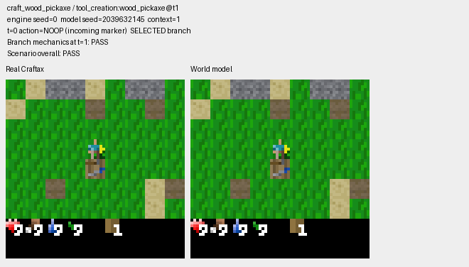
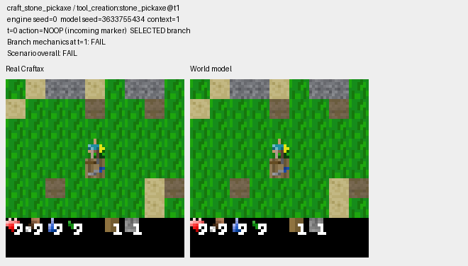

# TinyWMCraft Mechanics Validation

Tests whether a TinyWMCraft world model reproduces selected **Craftax-Classic game mechanics**, not just plausible-looking frames. Each scenario starts from a controlled real game state; the checkpoint receives RGB observations and actions, generates the subsequent frames, and is judged using independent visual measurements. The tests do not train a model or agent.

**[Example interactive results](example/index.html)** (open the downloaded HTML locally). The example folder contains all saved case verdicts and diagnostic details plus two illustrative GIFs; full generated GIF collections belong in local run outputs.

Current atomic verdict, coverage and conditional-selection rules are detailed in [PROTOCOL.md](PROTOCOL.md).

## Tests and experimental setup

All ordinary tests use **one real conditioning frame**, **16 autoregressively generated steps**, **one model draw per initial state**, and a selected action sequence paired with a NOOP/alternative sequence. Both branches use the same initial game state and model random keys. There are 27 distinct scenario types in total; groups overlap and must not be added together as independent scenarios.

| Experiment | Tests | Engine seeds | Attempts | Example checkpoint: PASS / FAIL / UNKNOWN |
|---|---|---|---:|---:|
| Diagnostic | All 27 scenario types, including combat and survival | 0 | 27 | 20 / 5 / 2 |
| Focused mechanics | 14 crafting, resource and persistence cases | 0–9 | 140 | 101 / 39 / 0 |
| Controlled movement | Free/blocked movement, turn loop, NOOP, table-return | 0–9 | 50 | 40 / 3 / 7 |
| Table placement | Place a crafting table | 0–9 | 10 | 10 / 0 / 0 |
| Conditional return | Table placement, six steps away and six back, with departure-only resampling | 0–9 | 10 retained of 22 attempts | 0 / 10 / 0 retained |

The four ordinary groups total **227 attempts / 454 paired branch recordings**. The conditional experiment reuses ten ordinary first samples and generates twelve retries, leaving **239 unique model trajectories / 478 unique branch recordings**. The example HTML includes 498 branch records because it also displays the ten reused samples in the conditional experiment. They are not additional independent trials.

| Mechanics | What is checked |
|---|---|
| Movement | Free movement, collisions, facing, screen translation, returning to a location |
| Crafting | Wood/stone/iron pickaxes, ingredient consumption, missing materials, table and furnace requirements |
| Gathering | Wood/stone collection, invalid actions, target removal, persistence of gathered resources |
| Placement | Crafting table/furnace creation, resource cost, blocked or resource-free attempts, object persistence |
| Combat/survival | Zombie attack, health change, death/termination evidence and sleep pose |
| Consistency | NOOP inventory stability, tool retention, resource/object persistence and paired-action consequences |

Fixtures use **Craftax-Classic 1.5.0** with controlled inventories, nearby objects, target blocks and enemies. Seed variation changes predefined peripheral terrain, lighting or irrelevant resources while retaining test feasibility. Ten engine seeds are not ten independent model-sampling seeds or entirely unrelated worlds. Future reference-engine state is never supplied to the generated-frame reader.

A scenario is **PASS** if its required mechanics agree with the independently observed generated frames, **FAIL** if a required fact is confidently contradicted, or **UNKNOWN** when the imagery cannot establish an outcome. Independent diagnostic measurements do not automatically change scenario verdicts. Dependent stages can be **NOT_TESTED** when prerequisites fail; inapplicable stages are excluded. Decision coverage is (PASS + FAIL) / attempted cases, including UNKNOWN in the denominator.

The special table-return scenario keeps the exact sequence `PLACE_TABLE → UP × 6 → DOWN × 6`. Conditional sampling retries only when the generated departure reveals a confidently identified obstacle in a newly seen cell, up to 20 total attempts per engine seed. It never retries because a table disappears or the model fails to return. In the example, six selected attempts reached the original location and showed the table missing; four other selected failures did not meet the return prerequisite. Conditional performance is reported separately from unconditional first samples.

## Run on another checkpoint

Python 3.11 and a compatible model adapter are required. Install dependencies from the repository root:

```bash
uv venv --python 3.11
uv pip install --python .venv/bin/python -r pyproject.toml
```

**One command runs all test groups, scores RGB evidence, performs conditional retries and generates the interactive HTML report with all GIFs:**

```bash
.venv/bin/python -m mechanics_eval --model /path/to/model.npz
```

The runner creates a unique directory under `mechanics_eval/runs/`; nothing is overwritten. To choose an output location and export only failed-case GIFs:

```bash
.venv/bin/python -m mechanics_eval --model /path/to/model.npz --out mechanics_eval/runs/my-checkpoint --gifs fail
```

Use `--gifs all|fail|unknown|nonpass|none` (default `all`). The GIF setting affects only media: **all verdicts, case details and scores are retained**. With `--gifs none`, the interactive report still works, but no animations are generated.

```text
mechanics_eval/runs/<run-id>/
  run.json                 # checkpoint hash, configuration, completed stages
  results.json             # aggregate results for this checkpoint
  evidence/                # saved ordinary trajectories, four groups
  scores/                  # replayable scoring for each group
  conditional/             # retry decisions and conditional trajectories
  report/
    index.html             # open locally to inspect results
    gallery.json           # case-level data
    evidence.zip           # complete local evidence export
    ...                    # case JSON and selected GIFs
```

Other useful arguments: `--module train` (default), `--seed 0`, `--model-seed N`, `--batch-size 4`, `--max-samples 20`, `--seed-step 1`, and `--native-precision` (default is fp32). Run `python -m mechanics_eval --help` for the complete interface. Model modules must implement the `load_model`, `start` and `step` API (and optionally `heads`) used by `mechanics_eval/rollouts.py`. A checkpoint from a different architecture needs a compatible adapter.

The internal `python -m mechanics_eval.cli` commands remain available for collecting individual groups, rescoring saved RGB, auditing readers and rebuilding the gallery without inference.

## Example result

| Wood pickaxe: PASS | Stone pickaxe: FAIL |
|---|---|
|  |  |

[Inspect all cases in the example report](example/index.html). Its HTML runs without a server, but GitHub's source-code preview does not execute it: download the `example/` folder and open `index.html` in a browser.

The example results come from a specific local checkpoint (SHA256 `b4d7b82ba698f1b7aeaab7383c324523bf27bde1aba2fe817745fce38efa0aef`), using CPU, fp32, batch size 4, one-frame conditioning and 16-step rollouts. **The original checkpoint and raw RGB trajectories are not included in Git.** Running a compatible but different checkpoint produces a new experiment, not an exact reproduction of these numbers.

**Candidate, not finalized:** independent generated-image reader validation remains pending.

## Limitations and provenance

Only visually supported observations receive decided verdicts. Ambiguous textures, occlusion, camera localization and termination can remain UNKNOWN. The new generated-image pose/identity readers and two borderline camera movements have automated controls and prior inspections, but their independent image-level confirmation is not documented as complete. These limitations do not prevent running the suite.

Tests use controlled fixtures and limited draws; they do not measure long-horizon gameplay, full world consistency or an RL agent's performance. Keep unconditional and conditionally sampled results separate.

Based on [TinyWMCraft](https://github.com/Maharishiva/tinywmcraft) by Fedor Kurdov ([MIT license](../LICENSE)) and [Craftax](https://github.com/MichaelTMatthews/Craftax). The original root README, docs, training code and frozen upstream evaluator remain unchanged.

## Individual stages and offline exports

Run advanced commands from the repository root. The CLI retains `collect`, `score`, `conditional-route`, `export-gallery` / `export-gifs`, `export-review`, `audit-reader`, `audit-missing`, `export-human-review` and `summarize-human-review`. Each subcommand supports `--help`.

```sh
python -m mechanics_eval.cli collect --suite focused --samples 10 --context 1 --horizon 16 --model path/to/model.npz --module train --fp32 --out mechanics_eval/runs/focused-evidence
python -m mechanics_eval.cli score --evidence mechanics_eval/runs/focused-evidence --out mechanics_eval/runs/focused-scores
python -m mechanics_eval.cli export-gallery --evidence mechanics_eval/runs/focused-evidence --results mechanics_eval/runs/focused-scores/results.json --gifs fail --out mechanics_eval/runs/focused-gallery
```

`collect` also supports `--scenario NAME ...`, `--seed`, `--model-seed`, `--model-samples`, `--batch-size`, `--module`, `--fp32`, `--context` and `--horizon`. `--context 8` is optional compatibility mode, with seven real NOOP initialization steps; it is not the current one-frame protocol. `score --measurements DIR` can replay matching saved RGB readings; `--conditional-fixed-route` requires the complete six-tile route. `conditional-route` uses `--first-evidence`, optional `--first-measurements`, matching model/module/precision, `--max-samples`, `--seed-step` and a new `--out` directory. Gallery exports accept matching lists `--evidence DIR ... --results JSON ...`; all five GIF modes are supported without inference or rescoring. `export-human-review --runs-root RUN` refers to the single runner output directory (or provide `--results JSON ...` explicitly).

### Reproducibility

The recorded historical example used sampling `STEPS=8`, `CTX_SIGNAL=0.9`. New runs record checkpoint/module/source hashes, backend/package versions, actions, engine/model seeds, batch offsets/indices and sampling settings. Reusing the same checkpoint, backend and batch composition is necessary for identical frames. A different compatible checkpoint is a new experiment. The snapshot preserves the source report hash as provenance; private report paths, raw RGB and checkpoint files are not published.

### Tests and local artifacts

```sh
python -m unittest discover -s mechanics_eval/tests -v
node mechanics_eval/tests/check_gallery_dom.cjs mechanics_eval/example/index.html
```

Tests use real engine controls and synthetic failure/frozen/unknown controls without learning anything. Real-model determinism tests require `MECHANICS_EVAL_CHECKPOINT=/absolute/path/model.npz`. Optional historical-example generated-RGB replay tests require `MECHANICS_EVAL_TEST_RUN=/absolute/path/run`, containing the original example RGB (not arbitrary new-checkpoint outputs), arranged in the runner's `evidence/` and `scores/` layout; an externally archived conditional corpus can additionally supply `scores/conditional-gallery-results.json`. Missing artifacts produce explicit skips; there is no automatic download. An optional separately installed `normuon_adapter` is checked only when available. Test outputs use a temporary directory. Checkpoints and run outputs are ignored, never committed. See [migration verification](MIGRATION.md) for what was actually run, including the limits of the checkpoint smoke test.
